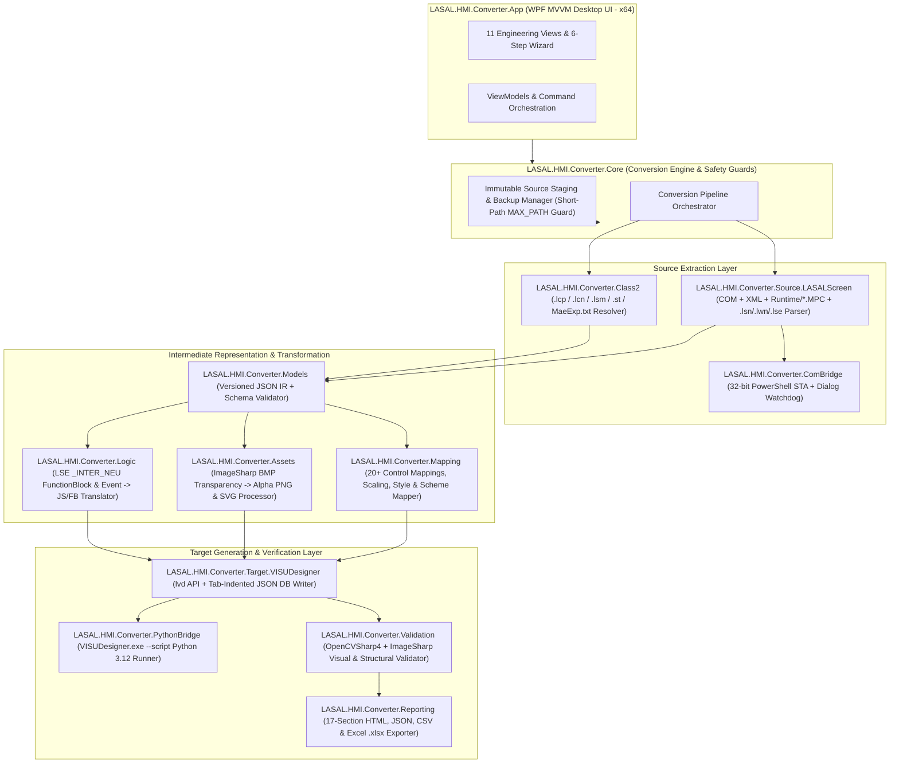

# LASAL HMI Converter — System Architecture

## 1. Architectural Overview

**LASAL HMI Converter** is a modular, production-grade Windows desktop engineering application (`.NET 9` WPF MVVM, x64) that migrates SIGMATEK LASAL SCREEN (`.lpr`) projects and associated LASAL CLASS 2 (`.lcp` / `.lsm` / `MaeExp.txt`) projects into native, editable SIGMATEK LASAL VISUDesigner (`.lvp`) projects.

---

## 2. Solution & Module Structure (`LASAL.HMI.Converter.sln`)

| Project | Target Framework | Responsibility |
|---|---|---|
| `src/LASAL.HMI.Converter.Models` | `net9.0` | Versioned Intermediate Representation (`HmiIntermediateModel` v1.0), source/target schemas, mapping models, validation models, and JSON schema validation. |
| `src/LASAL.HMI.Converter.Infrastructure` | `net9.0-windows` | Serilog structured logging (`logs\`), environment/version detector (`SoftwareEnvironmentDetector`), safe process runner, Win32 `#32770` modal dialog watchdog, and immutable short-path staging manager (`StagingManager`). |
| `src/LASAL.HMI.Converter.ComBridge` | `net9.0-windows` | Out-of-process 32-bit COM bridge invoking `C:\Windows\SysWOW64\WindowsPowerShell\v1.0\powershell.exe` in STA mode against `LASALScreen.Application` (`CLSID {82A49236-710D-4A68-8D66-1FC2312CABAB}`). Executes project open, compile, server list export, and unlocked headless XML export (`ExportLanguagesToXML` + `ExportTextListsToXML` + `AddContainerInfo` + `ExportToXML`). |
| `src/LASAL.HMI.Converter.Source.LASALScreen` | `net9.0-windows` | Deep LASAL SCREEN project extractor combining COM automation, XML export parsing, compiled `Runtime\*.MPC` binary parsing (`LSE.MPC`, `GS0000.MPC`, `LC*.MPC`, `LW*.MPC`, `LS0000.MPC`..`LS0020.MPC`), and `.lsn`/`.lwn`/`.lse` MFC `CArchive` inspection. |
| `src/LASAL.HMI.Converter.Class2` | `net9.0` | Parses LASAL CLASS 2 `.lcp`, `.lcn`, `.lsm`, `.lss`, `.st`, and `MaeExp.txt` files to resolve PLC stations, classes, objects, servers, data types, initial values, and `_MyIO`/`_Global`/`_ScrollArea2`/`_Screen` companion classes. |
| `src/LASAL.HMI.Converter.Assets` | `net9.0` | SixLabors.ImageSharp image pipeline: extracts bitmaps from `Image\`, converts LASAL SCREEN transparent key RGB pixels (`#FF00FF` or custom key) to true 32-bit RGBA PNG alpha transparency, preserves SVGs, and deduplicates asset filenames. |
| `src/LASAL.HMI.Converter.Mapping` | `net9.0` | Configurable rule engine mapping all 20+ LASAL SCREEN element types (`_BUTTON`, `AS_NUMERIC`, `AS_ASCII`, `AS_CHKBOX`, `AS_RADIO`, `AS_BAR`, `AS_DATE`, `AS_TIME`, `AS_ENUMERATION`, `AS_THEURGE`, `AS_MENU`, `_RECTANGLE`, `_CIRCLE`, `_POLYGON`, `_PICTEXT`, `_MOTION`, `_OBJECT`, `_AlarmDisplay`, `_Graph`, `_ScrollArea2`, `_Carousel`) to native `sigmatek.*` VISUDesigner controls, with coordinate scaling and user JSON override support. |
| `src/LASAL.HMI.Converter.Logic` | `net9.0` | Translates LASAL SCREEN `_INTER_NEU` FunctionBlocks (`LseMirr`, arithmetic, comparisons, boolean logic, `Switch`), button actions, and `_Global` commands into VISUDesigner FunctionBlocks (`Functionblocks\*.json` + `*.js`) and JavaScript CodeModules (`CodeModules\MigratedLogic.js`), validating generated JS syntax and datapoint references. |
| `src/LASAL.HMI.Converter.PythonBridge` | `net9.0-windows` | Manages serialized execution of `VISUDesigner.exe --script <script.py>` using embedded Python 3.12 (`sigmatek.lasal.lvd`), passing parameters and capturing structured JSON results via marker files. |
| `src/LASAL.HMI.Converter.Target.VISUDesigner` | `net9.0-windows` | Generates native `.lvp` projects: invokes `lvd.CreateProject`, writes tab-indented JSON files (`Dashboards`, `GlobalDashboards`, `Window`, `ControlTemplate`, `View/Default.json`, `Datapoints`, `Stations`, `Localization`, `Textlists`, `Schemes`, `FontStyles`, `Units`, `Alarms`, `Menu`, `Functionblocks`, `CodeModules`, `ColorPalettes`), and runs `lvd` synchronization (`AddMediaItems`, `ValidateAndSynchronizeTextLists`, `UpdateComponentProperties`, `SynchronizeLogicElements`, `UpdatePropertyValues`, `SaveProject`, `PublishProject`). |
| `src/LASAL.HMI.Converter.Validation` | `net9.0-windows` | Visual and structural validation engine: renders source layout preview and target VISUDesigner dashboard/webroot preview, computes pixel/structural similarity and bounding-box delta metrics via OpenCVSharp4 and ImageSharp, and validates datapoints, text bindings, assets, and published `webroot` bundles. |
| `src/LASAL.HMI.Converter.Reporting` | `net9.0` | Generates comprehensive 17-section conversion reports in HTML (self-contained interactive report), JSON, CSV, and Excel (`.xlsx` via ClosedXML). |
| `src/LASAL.HMI.Converter.Core` | `net9.0-windows` | Coordinates the end-to-end conversion workflow, progress reporting, cancellation tokens, source immutability verification (SHA-256 pre/post check), and diagnostic checks. |
| `src/LASAL.HMI.Converter.App` | `net9.0-windows` | WPF MVVM desktop application providing all 11 navigation views and the 6-step conversion wizard. |
| `tools/Diagnostic` | `net9.0-windows` | CLI diagnostic utility that inspects installed LASAL versions, COM registration, Python 3.12 `lvd` scripting, and sample project readiness. |
| `tools/ManualIndexer` | `net9.0` | CLI tool that scans `01_Manuals` and `.chm` files and generates structured index/reference manifests. |
| `tools/ProjectInspector` | `net9.0-windows` | CLI tool that extracts any `.lpr` or `.lvp` project to Intermediate Representation JSON and prints a full structural inventory. |

---

## 3. Strict Engineering & Safety Guarantees

1. **Zero Source Modification Guarantee**:
   - Before opening any `.lpr` project in `LASALScreen.Application` or parsing its files, `StagingManager` computes SHA-256 hashes of the source files and copies the project directory to an isolated short-path staging folder (`%TEMP%\LasalHmiConverter\stage_<id>\`).
   - All COM automation (`Open`, `Compile`, `ExportServerlist`, `ExportToXML`) operates exclusively on the staged copy.
   - After extraction completes, `StagingManager` verifies that the original source files' SHA-256 hashes and timestamps are 100% unchanged.
2. **32-bit / 64-bit Architecture Isolation**:
   - The main WPF application runs as a 64-bit (`x64`) process.
   - `LASALScreen.Application` (`LSE_Modeless.exe`) is invoked exclusively via `C:\Windows\SysWOW64\WindowsPowerShell\v1.0\powershell.exe -Sta` in `LASAL.HMI.Converter.ComBridge` with an active Win32 `#32770` modal dialog watchdog.
3. **No PLC Download or Production Machine Impact**:
   - The converter contains zero PLC download, online variable write, or production deployment functions.
